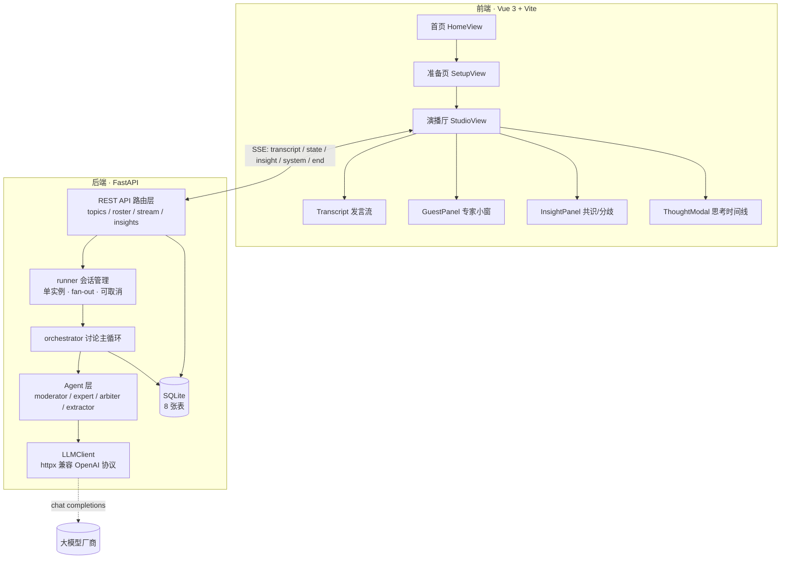

# AI Panel Studio · AI 圆桌演播厅

> 输入一个议题，瞬间召集一支「虚拟智库」——主持人主导、专家自主举手抢答与反驳，全过程实时流式呈现，共识与分歧在讨论进行中即时生长。

**AI Panel Studio** 是一个**本地运行的多 Agent 圆桌讨论 Web 应用**。用户输入讨论话题并指定专家人数（2–6，默认 4），系统调用大模型生成主持人与专家阵容（姓名 / 职业 Title / 立场 / 专属颜色），确认后进入「演播厅」，观看一场由多个独立 Agent 实时推演、可回放、可随时中断的圆桌讨论。

---

## 目录

- [核心特性](#核心特性)
- [效果演示流程](#效果演示流程)
- [系统架构](#系统架构)
- [技术栈](#技术栈)
- [目录结构](#目录结构)
- [快速开始](#快速开始)
- [环境变量](#环境变量)
- [API 一览](#api-一览)
- [SSE 事件协议](#sse-事件协议)
- [核心机制](#核心机制)
- [测试](#测试)
- [文档索引](#文档索引)
- [不在 MVP 范围](#不在-mvp-范围)
- [许可证](#许可证)

---

## 核心特性

| 特性 | 说明 |
|------|------|
| 🎙 **主持人主导** | 主持人 Agent 负责开场、每轮追问与串联、讨论饱和后收尾总结，强力控场而非机械轮流 |
| ✋ **专家自主举手** | 每位专家独立决策「是否举手」及发言意图（抢答 / 补充 / 反驳），不预设发言顺序 |
| ⚔️ **立场强对立** | 阵容生成时赋予专家鲜明且互斥的立场，讨论中互相点名反驳、保持立场一致性 |
| 📡 **全程实时流式** | SSE 逐字推送发言增量与嘉宾状态切换（待机 / 举手 / 准备 / 发言中） |
| 🧠 **思考过程可见** | 每位嘉宾的举手思考摘要实时可见，并可单独打开弹窗查看其完整思考时间线 |
| ⚖️ **实时共识与分歧** | 每轮发言后增量抽取共识 / 分歧条目，讨论进行中即时增长，非结束后批量生成 |
| 🔊 **可回放** | 已归档讨论可完整回放发言与共识分歧 |
| ⏹ **可强制中断** | 讨论进行中可一键中断，已产生的发言与共识保留，话题转入「已中断」可回看 |
| 🛡 **过载容错** | 识别上游「HTTP 200 + 流体内嵌错误帧」的伪成功，指数退避重试，避免静默空发言 |
| 📱 **响应式布局** | 超宽屏 / 桌面 / 窄屏自适应，各区域在自身容器内独立滚动 |

---

## 效果演示流程

```
首页（讨论列表）
   │  点击「+ 发起新讨论」
   ▼
准备页 ── 输入话题 + 专家人数 ──▶ 生成阵容（LLM）
   │                                  │
   │                          展示主持人 + N 位专家档案
   │                          可「重新生成」或「确认阵容」
   ▼
演播厅 ── 主持人开场
   │
   ├─▶ 循环：专家并发举手决策 → 仲裁排序 → 依次流式发言 → 主持人追问串联 + 判断是否继续
   │                                                        ├─ 每轮增量抽取共识 / 分歧
   │                                                        └─ 可随时「⏹ 中断讨论」
   ▼
主持人收尾总结 ──▶ 归档（archived）──▶ 可回放
```

---

## 系统架构



**关键设计**：API Key 仅存于后端，从 `.env` 读取，绝不下发浏览器；每位 Agent 只读取最近 K 条发言（默认 8）作为上下文，避免长上下文幻觉。

---

## 技术栈

| 层 | 选型 |
|----|------|
| 后端框架 | FastAPI 0.115 |
| ORM / 数据库 | SQLAlchemy 2.0 + SQLite（开启 `PRAGMA foreign_keys=ON`） |
| 配置管理 | pydantic-settings（从 `.env` 读取） |
| 实时推送 | sse-starlette 2.1（Server-Sent Events） |
| LLM 调用 | httpx 直调兼容 OpenAI 协议的 `/chat/completions`（不引入官方 SDK） |
| 前端框架 | Vue 3（Composition API，`<script setup>`） |
| 路由 | Vue Router 4 |
| 样式 | TailwindCSS 3 |
| 构建 | Vite 5 |
| HTTP 客户端 | axios |

---

## 目录结构

```
AI Panel Studio/
├── .gitignore
├── README.md
├── docs/                       # 产品与设计文档
│   ├── PRD.md                  # 产品需求文档（含主流程 / 状态机 / 共识分歧时机）
│   ├── schema.md               # 数据库设计（ER 图 / 表结构 / 索引 / DDL）
│   └── 完善后端LLM调用-MVP.md   # LLM 链路实现计划与实施记录
├── backend/                    # FastAPI 后端
│   ├── .env.example
│   ├── requirements.txt
│   ├── app/
│   │   ├── main.py             # 应用入口（lifespan 建表 + 预热/关闭 LLMClient）
│   │   ├── config.py           # 配置（API Key 仅后端可见）
│   │   ├── database.py         # engine / session / 外键 PRAGMA
│   │   ├── models/             # ORM：Topic / Guest / Transcript / EventPoint / Insight …
│   │   ├── schemas/            # Pydantic v2 API 契约
│   │   ├── api/                # 路由：topics / roster / stream / insights + 状态机校验
│   │   ├── llm/                # LLMClient（chat / chat_stream / chat_json）+ Prompt 模板
│   │   ├── agent/              # base / moderator / expert / arbiter / extractor
│   │   └── stream/             # SSE 事件工厂 / runner 会话管理 / orchestrator 主循环
│   └── scripts/
│       ├── init_db.py          # 建表 + 样例数据（5 话题 / 25 嘉宾）
│       └── e2e_test.py         # 端到端验证脚本
└── frontend/                   # Vue 3 前端
    ├── .env.example
    ├── vite.config.js          # 端口 5173，代理 /api → localhost:8000
    └── src/
        ├── api/                # axios 封装 + 各资源接口 + SSE 订阅
        ├── components/         # Transcript / GuestPanel / InsightPanel / ThoughtModal …
        ├── views/              # HomeView / SetupView / StudioView
        ├── router/
        └── mock/               # 离线演示用 mock 数据
```

---

## 快速开始

### 环境要求

- Python **3.10+**
- Node.js **18+**
- 一个兼容 OpenAI 协议的大模型 API Key（DeepSeek / Moonshot / 智谱 / OpenAI 等均可）

### 1. 启动后端

```bash
cd backend

# 创建并激活虚拟环境
python -m venv .venv
.venv\Scripts\activate          # Windows
# source .venv/bin/activate     # macOS / Linux

pip install -r requirements.txt

# 配置环境变量（填入真实 LLM_API_KEY）
copy .env.example .env          # Windows
# cp .env.example .env          # macOS / Linux

# 初始化数据库 + 插入样例数据
python scripts/init_db.py

# 启动服务
uvicorn app.main:app --reload --port 8000
```

验证：访问 <http://localhost:8000/health>，应返回 `"llm": {"configured": true, ...}`（该响应**不会**包含 API Key）。
交互式接口文档：<http://localhost:8000/docs>

### 2. 启动前端

```bash
cd frontend
npm install

copy .env.example .env          # Windows（确保 VITE_USE_MOCK=false 走真实后端）
# cp .env.example .env          # macOS / Linux

npm run dev
```

打开 <http://localhost:5173>，即可发起新讨论。前端通过 Vite 代理把 `/api` 转发到后端 `8000` 端口，无需额外 CORS 配置。

### 3. 生产构建（可选）

```bash
cd frontend && npm run build    # 产物输出到 frontend/dist/
```

---

## 环境变量

后端从 `backend/.env` 读取（模板见 `backend/.env.example`）：

| 变量 | 必填 | 默认值 | 说明 |
|------|:----:|--------|------|
| `LLM_API_KEY` | ✅ | — | 大模型 API Key，**仅后端读取**，不通过任何 API 响应暴露 |
| `LLM_BASE_URL` | | `https://api.deepseek.com/v1` | 兼容 OpenAI 协议的 Base URL |
| `LLM_MODEL` | | `deepseek-chat` | 模型名称 |
| `LLM_TEMPERATURE` | | `0.7` | 默认温度（各 Agent 会按用途覆盖） |
| `APP_ENV` | | `dev` | 运行环境：`dev` / `test` / `prod` |
| `APP_HOST` | | `0.0.0.0` | 监听地址 |
| `APP_PORT` | | `8000` | 监听端口 |
| `DATABASE_URL` | | `sqlite:///./ai_panel_studio.db` | SQLite 连接串 |
| `MAX_TURNS` | | `8` | 专家发言最大轮次，达到后主持人强制收尾 |
| `AGENT_CONTEXT_WINDOW_K` | | `8` | 每位 Agent 读取最近 K 条发言作为上下文 |

前端从 `frontend/.env` 读取：

| 变量 | 默认值 | 说明 |
|------|--------|------|
| `VITE_USE_MOCK` | `true` | `true` 用本地 mock 数据（纯前端演示）；`false` 走真实后端 |
| `VITE_API_BASE_URL` | 空 | 后端 Base URL；留空则走 Vite 代理 `/api` |

> ⚠️ **安全**：`.env` 已被 `.gitignore` 忽略，请勿提交。仓库仅保留 `.env.example`。

---

## API 一览

统一前缀 `/api`。完整交互式文档见 `/docs`。

### 元信息

| 方法 | 路径 | 说明 |
|------|------|------|
| GET | `/health` | 健康检查 + LLM 配置状态（不含 Key） |

### 讨论（topics）

| 方法 | 路径 | 说明 |
|------|------|------|
| GET | `/api/topics` | 讨论列表（支持分页与状态过滤） |
| POST | `/api/topics` | 创建讨论（初始 `draft`） |
| GET | `/api/topics/{topic_id}` | 讨论详情（含嘉宾阵容） |
| PATCH | `/api/topics/{topic_id}` | 更新状态 / 总结（走状态机校验） |
| POST | `/api/topics/{topic_id}/start` | 触发讨论进入 `ongoing` |
| GET | `/api/topics/{topic_id}/guests/{guest_id}/thoughts` | 某位嘉宾的思考时间线 |

### 阵容（roster）

| 方法 | 路径 | 说明 |
|------|------|------|
| POST | `/api/topics/{topic_id}/roster/generate` | 调 LLM 生成候选阵容（主持人 + N 专家） |
| GET | `/api/topics/{topic_id}/roster` | 获取当前阵容 |
| POST | `/api/topics/{topic_id}/roster/confirm` | 确认阵容 |

### 实时流（stream）

| 方法 | 路径 | 说明 |
|------|------|------|
| GET | `/api/topics/{topic_id}/stream` | **SSE** 实时推送发言 / 状态 / 共识分歧 |
| POST | `/api/topics/{topic_id}/stream/cancel` | 强制中断讨论（置为 `cancelled`） |
| GET | `/api/topics/{topic_id}/stream/replay` | 回放已归档 / 已中断的讨论 |

### 共识与分歧（insights）

| 方法 | 路径 | 说明 |
|------|------|------|
| GET | `/api/topics/{topic_id}/insights` | 共识 / 分歧列表 |
| GET | `/api/topics/{topic_id}/insights/{insight_id}` | 单条详情（含关联发言与推理链） |

---

## SSE 事件协议

`GET /api/topics/{id}/stream` 返回的每条事件均为 `{ event, data(JSON 字符串) }`：

| `event` | 触发时机 | `data` 主要字段 |
|---------|----------|-----------------|
| `system` | 阶段推进 / 异常提示 | `topic_id`, `message`, `phase`（`opening` / `expert_decide` / `no_speaker` / `extract` / `decide` / `closing` / `summary` / `finalize`） |
| `state` | 嘉宾状态切换 | `guest_id`, `guest_name`, `guest_color`, `state`（`idle` / `hand_raised` / `preparing` / `speaking`）, `thought` |
| `transcript` | 发言流式增量 | `transcript_id`, `guest_id`, `turn_index`, `speech_type`, `status`（`streaming` / `done` / `aborted`）, `delta`, `content` |
| `insight` | 共识 / 分歧增量 | `insight_id`, `action`（`create` / `update` / `finalize`）, `type`, `summary`, `strength`, `version`, `is_final` |
| `heartbeat` | 保活 | — |
| `end` | 讨论结束 | `topic_id`, `summary` |

前端按 `transcript_id` 聚合增量（多条 `streaming` → 一条 `done` 覆盖全量），按 `insight_id` upsert。

---

## 核心机制

### 多 Agent 调度

遵循「**分阶段、分目的、分上下文**」原则：主持人、专家、抽取器各自持有独立的 system prompt 与上下文窗口（最近 K=8 条发言），避免单 Prompt 长上下文导致的幻觉与「念稿感」。

### 举手与仲裁

每轮开始时，**所有专家并发**做一次举手决策（低温度、限定 token 的 JSON 输出），返回是否举手及发言意图；由仲裁器按固定优先级排序，同级按举手先后 FIFO：

```
grab（提出新观点） > supplement（补充论据） > rebute（反驳）
```

每轮最多 3 位专家发言。举手、仲裁过程作为内部事件写入 `event_point` 表，**不出现在 Transcript**。

### 主持人收尾判据

主持人不再以「达成共识」为收尾条件（强对立阵容本就不会趋同），而是判断**讨论是否原地打转**：

- 由主持人 Agent 自主判定（结合本轮是否出现新论据 / 新例证）
- 配合「上一轮新增洞见数为 0」的 stale 信号
- **最低轮次保障**（至少 2 轮）避免过早收尾
- **最大轮次兜底**（`MAX_TURNS`，默认 8）避免无限讨论
- 判定解析失败时保守选择「继续」

### 流式性能与容错

| 问题 | 处理 |
|------|------|
| 每轮多次 LLM 往返导致等待感强 | 主持人「追问串联」与「是否继续」合并为**一次**流式调用，标记随文本尾部返回并剥离 |
| 等最慢专家才集体举手 | 举手决策用 `FIRST_COMPLETED` 语义，**谁先返回谁先推送**状态 |
| 发言首 token 前的空白 | 先推送空 delta 占位，前端立即显示发言人，随后逐字填充 |
| 上游过载伪装成功 | 识别 `HTTP 200 + 流体内嵌 {"error": ...}` 帧，指数退避重试（2/4/8s）；已产出内容后不重试，避免发言重复 |
| 多个浏览器窗口开同一讨论导致重复运行 | 服务端每场讨论**单实例** orchestrator，多观察者 fan-out 共享事件，晚加入自动补发历史 |
| SSE 丢事件导致发言缺失 | 讨论结束后用 replay 接口补全 / 校正本地发言列表 |

### 中断与回放

`POST /api/topics/{id}/stream/cancel` 取消后台编排任务并把话题置为终态 `cancelled`（同时写入 `ended_at`）。已产生的发言与共识分歧全部保留，可经 replay 接口回放。

---

## 测试

端到端验证脚本会自行在独立端口拉起一个 uvicorn 子进程、使用独立测试数据库，覆盖 HTTP API、SSE 事件协议、数据库持久化与回放等主流程：

```bash
cd backend
python scripts/e2e_test.py
```

脚本复用 `backend/.env` 中的 LLM 配置，不写入生产数据库。运行结束会打印 `结果: N/N 通过`。

> 提示：该脚本会真实调用大模型，耗时与所选厂商的推理速度相关。

---

## 文档索引

| 文档 | 内容 |
|------|------|
| [docs/PRD.md](docs/PRD.md) | 产品需求文档：业务流程、主持人与专家状态机、共识/分歧生成时机、验收标准 |
| [docs/schema.md](docs/schema.md) | 数据库设计：ER 图、8 张表字段定义、索引、枚举、完整 DDL |
| [docs/完善后端LLM调用-MVP.md](docs/完善后端LLM调用-MVP.md) | LLM 链路实现计划与实施记录（含关键设计约束） |

---

## 不在 MVP 范围

- 用户账号与鉴权体系（本地应用，无登录）
- 讨论录制导出为视频
- 多语言 UI（当前仅中文）
- 专家阵容逐字段手动编辑（仅支持「重新生成」）
- 跨讨论的知识沉淀

---

## 许可证

本仓库尚未添加开源许可证。若计划公开发布，建议补充 `LICENSE` 文件（如 MIT / Apache-2.0）并在本节说明。
