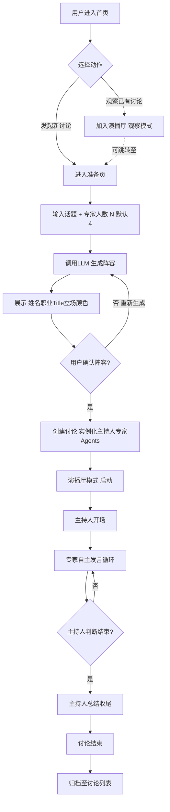
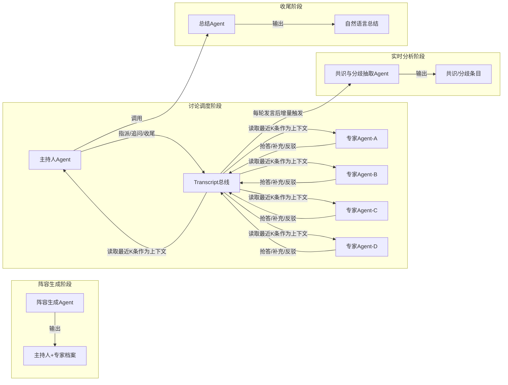
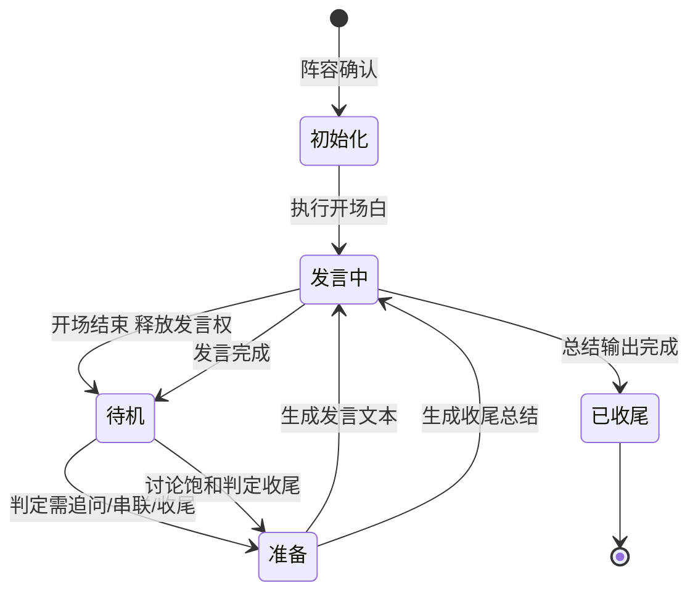
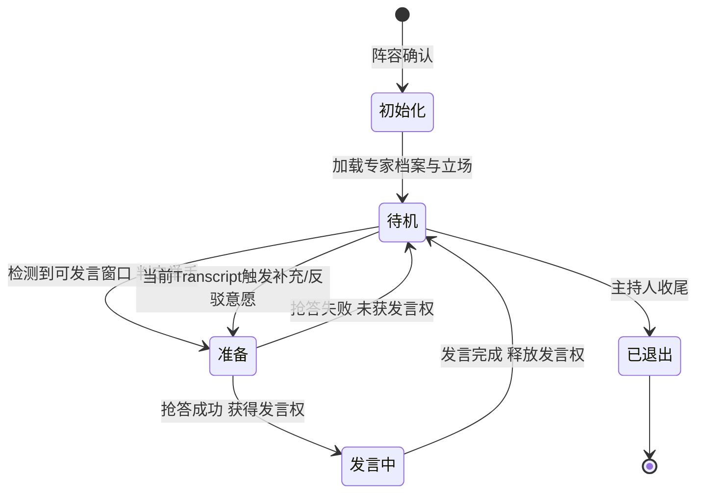
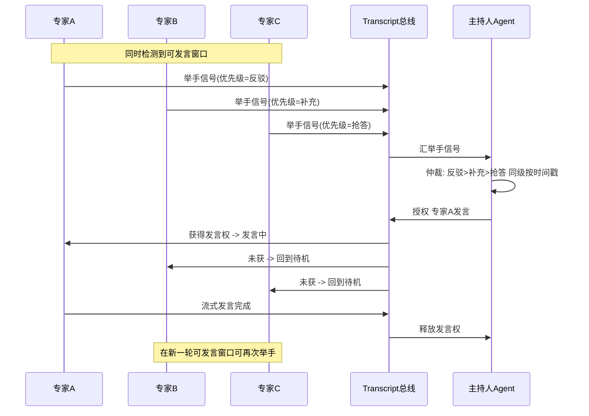
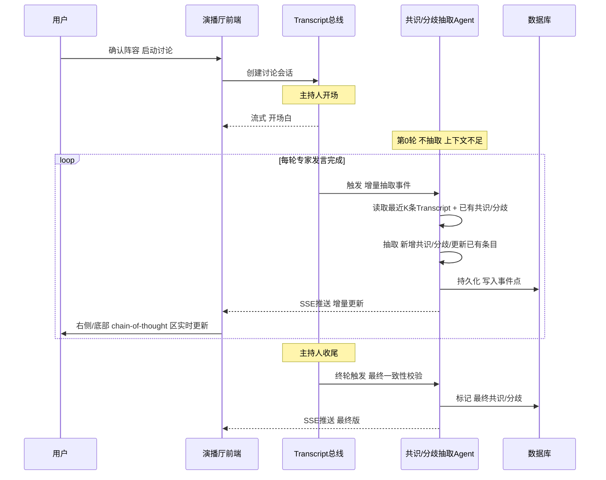

# AI Panel Studio — 产品需求文档（PRD）

> **文档版本**：v1.0
> **产品代号**：AI Panel Studio / AI 圆桌讨论 Web App MVP
> **文档状态**：基线版（用于驱动后续 DDD/OOD/TDD/E2E 阶段）
> **作者**：产品组

---

## 0. 文档目的与读者

本 PRD 作为 AI 圆桌讨论 Web App MVP 的**唯一产品基线文档**，服务于以下读者：

- **开发（含 AI 协同）**：作为 Prompt 工程与功能拆解的输入源，约束"做什么 / 不做什么 / 何时算完成"。
- **测试**：作为验收用例的依据，特别是状态机与实时性相关用例。
- **设计**：作为演播厅视觉风格、专家小窗、Transcript 区域的交互约束。

文档聚焦三个**必须可执行、可验收**的核心约定：

1. **核心业务流程流转说明**（§3）
2. **主持人与专家的状态机定义**（§5）
3. **实时共识与分歧的生成时机**（§6）

其余章节为支撑性内容，帮助读者建立共识。

---

## 1. 产品概述

### 1.1 产品定位

**「AI Panel Studio」** 是一款 **"AI 圆桌讨论"** 本地 Web 应用：用户输入任意讨论话题并指定参会专家人数（默认 4 人），系统调用大模型生成一组主持人与专家阵容，展开多轮观点碰撞的姓名、职业、Title、立场与专属颜色标识；用户确认阵容后进入演播厅讨论模式，观看一组由 AI 驱动、实时推演的圆桌讨论。

### 1.2 核心价值主张

让任何人都瞬间召集一支"虚拟智库"，围绕任意议题展开深度碰撞——主持人负责开场、追问、串联与收尾，专家之间自主"举手"抢答补充与反驳，讨论过程中持续生成知识与分歧，最终呈现一场沉浸式的 AI 圆桌实况。

### 1.3 设计原则

| 原则 | 含义 | 验收要点 |
|------|------|----------|
| 沉浸感优先 | 让用户"像在看一场演播厅直播"，而非"在等 LLM 流式返回" | Transcript 与专家小窗的节奏、停顿、状态切换必须自然 |
| 过程可见 | chain-of-thought、共识与分歧**实时生成**，不堆积到结束才出现 | 见 §6 生成时机约束 |
| 上下文受控 | 多 Agent 分阶段、分目的协作，避免单 Prompt 长上下文幻觉 | 见 §3.3 调度策略 |
| 草稿胜过完美品 | 工程化拆解、过程可溯优先于"一键生成" | 见 §8 提交物约束 |

---

## 2. 用户画像与痛点

### 2.1 目标用户画像

| 用户群体 | 特征描述 | 核心诉求 |
|---------|---------|---------|
| AI 工作者与研究人员 | 需要快速对一个议题进行多角度审视，时间有限 | 在几分钟内获得来自不同视角的深度分析与争辩摘要 |
| 产品/战略人员 | 在方案评审或战略讨论前希望预演各方立场与潜在争议 | 用 AI 圆桌发现盲点、检验假设、提升决策质量 |
| 教育与内容创作者 | 需要将复杂议题结构化呈现给受众，追求沉浸感与叙事性 | 获得一场可录制、可回放的"虚拟专家访谈"作为内容素材 |

### 2.2 用户痛点

1. **视角单一**：使用单一 AI 对议题的分析往往立场单一，缺乏真实辩论中"对抗性思考"所带来的深度。
2. **异步割裂**：多次单独询问不同角色的 AI，上下文割裂，观点之间无法真正产生互动与碰撞。
3. **过程不可见**：AI 输出结果以最终结论呈现，缺乏"思考过程"和"观点演化"的实时感与沉浸感。
4. **议程管理难题**：用户希望同时探索多个议题，但不同讨论的分支、逻辑与结论难以并行跟踪管理。

---

## 3. 核心业务流程流转说明（必读）

### 3.1 主流程总览



### 3.2 阶段定义与交付边界

| 阶段 | 入口条件 | 出口条件 | 产物 |
|------|----------|----------|------|
| **首页（List）** | 用户打开应用 | 用户点击"发起新讨论"或"加入讨论" | 讨论列表项（标题、状态、参与人数、最近更新） |
| **准备页（Setup）** | 用户进入准备页 | 用户确认阵容 | 候选阵容 JSON（主持人 + N 专家） |
| **演播厅（Studio）** | 阵容确认且实例化完成 | 主持人输出收尾总结 | Transcript、chain-of-thought、共识/分歧、总结 |
| **结束（Archive）** | 主持人收尾完成 | 归档写入数据库 | 可回放讨论记录 |

### 3.3 多 Agent 调度策略（避免幻觉的核心约定）

为避免单 Prompt 长上下文导致的幻觉与"念稿感"，调度遵循"**分阶段、分目的、分上下文**"原则：



**关键约束**：

- 每位 Agent 读取上下文窗口**只看最近 K 条 Transcript**（K 默认 8），而非全量历史，降低上下文长度与幻觉概率。
- **抢答/反驳**由专家 Agent 自行决策，主持人 Agent **不预先指定发言顺序**，模拟真实圆桌的"举手"机制。
- 主持人 Agent 在以下情况介入：开场、追问、串联话题、判断讨论饱和后收尾总结。

---

## 4. 功能模块需求

### 4.1 首页

| 需求项 | 说明 |
|--------|------|
| 列表展示 | 展示当前所有正在进行的讨论列表，含标题、状态（进行中/已结束）、专家数、最近更新时间 |
| 加入讨论 | 用户可加入观察已有讨论（只读观察模式） |
| 发起新讨论 | 显著入口，点击后进入准备页 |

### 4.2 准备页

| 需求项 | 说明 |
|--------|------|
| 输入项 | 话题（必填）、专家人数（默认 4，范围 2-6） |
| 阵容生成 | 调用 LLM 生成主持人与专家阵容 |
| 阵容展示 | 每位嘉宾展示：姓名、职业/Title、立场、专属颜色标识 |
| 确认/重生成 | 用户可确认进入演播厅，或要求重新生成阵容 |

### 4.3 演播厅模式

| 需求项 | 说明 |
|--------|------|
| 主持人职责 | 开场 → 追问 → 串联 → 总结收尾 |
| 专家发言 | 基于当前 Transcript 自主决定发言顺序（举手抢答/补充/反驳），每轮 2-5 句话 |
| Transcript | 显示发言人姓名 + 职业/Title，颜色与专家一致；**不展示"举手"等内部事件** |
| chain-of-thought 区 | 讨论区右侧或底部中轴线，实时生成知识与分歧 |
| 专家状态小窗 | 每位专家独立小窗，实时显示状态（待机/准备/发言中）与思考摘要 |
| 结束总结 | 主持人以自然语言总结，**禁止将 JSON 原文展示到页面上** |

### 4.4 响应式与布局

- 中文 UI。
- 不依赖整页滚动，各区域在自身容器内独立滚动。
- 超宽屏、普通桌面、窄屏均合理分配区域。

---

## 5. 主持人与专家的状态机定义（必读）

### 5.1 主持人状态机

主持人 Agent 的状态空间：**待机 / 准备 / 发言中**，外加两个边界态：**初始化**（阵容确认后瞬时态）与**已收尾**（终态）。



| 状态 | 触发事件 | 进入动作 | 退出条件 |
|------|----------|----------|----------|
| 初始化 | 阵容确认 | 实例化主持人 Agent、加载话题上下文 | 开场白文本就绪 |
| 发言中 | 准备完成 | 流式输出至 Transcript，主持人小窗高亮 | 流式结束 |
| 待机 | 发言完成 | 释放发言权，等待专家抢答 | 检测到需要追问/串联/收尾 |
| 准备 | 待机判定介入 | 调用 LLM 生成发言文本（不流式到 Transcript） | 文本就绪 |
| 已收尾 | 收尾发言完成 | 触发讨论归档 | 终态 |

### 5.2 专家状态机

每位专家 Agent 独立持有状态机：**待机 / 准备 / 发言中**。边界态：**初始化**（阵容确认后）与**已退出**（讨论结束时）。



| 状态 | 触发事件 | 进入动作 | 退出条件 |
|------|----------|----------|----------|
| 初始化 | 阵容确认 | 实例化专家 Agent、加载专家档案与立场 | 档案加载完成 |
| 待机 | 初始化或抢答失败 | 监听 Transcript，决策是否举手 | 决策为"举手"或被收尾 |
| 准备 | 检测到可发言窗口 | 生成发言文本（含举手信号），进入抢答仲裁 | 抢答仲裁结果 |
| 发言中 | 抢答成功 | 流式输出至 Transcript，专家小窗高亮 | 流式结束 |
| 已退出 | 主持人收尾 | 终态，停止监听 | — |

### 5.3 抢答仲裁规则（多专家并发"举手"）

当多位专家同时进入"准备"态并发起举手信号时，由主持人 Agent 仲裁：



**优先级**：`反驳 > 补充 > 抢答`；同级按举手时间戳先进先发言。

### 5.4 状态机对外可见性约束

| 内部事件 | 是否在 UI 可见 | 处理方式 |
|----------|----------------|----------|
| 举手信号 | ❌ 不显示 | 仅作为内部状态转换依据 |
| 抢答仲裁过程 | ❌ 不显示 | 仅仲裁结果影响小窗状态 |
| 专家"准备"态 | ✅ 显示 | 小窗显示"准备发言"+ 思考摘要 |
| 专家"发言中"态 | ✅ 显示 | 小窗高亮 + Transcript 实时流式 |
| 主持人介入 | ✅ 显示 | Transcript 中以主持人身份出现 |

---

## 6. 实时共识与分歧的生成时机（必读）

### 6.1 设计目标

**核心约束**：chain-of-thought（知识与分歧）**必须实时生成并更新对应区域，不等到讨论结束后才生成**。这是"过程可见"原则的具体落地。

### 6.2 生成时机定义



### 6.3 触发条件矩阵

| # | 触发点 | 是否抽取 | 原因 |
|---|--------|----------|------|
| T0 | 主持人开场完成 | ❌ 不抽取 | 上下文不足，仅有一位发言者 |
| T1 | 第 1 位专家发言完成 | ✅ 抽取 | 出现首个立场，可记录为"分歧候选/共识候选"的初稿 |
| T2 | 第 2 位专家发言完成 | ✅ 抽取 | 出现 ≥2 立场，可判定分歧/共识 |
| Tn | 第 n 位专家发言完成（n≥3） | ✅ 增量抽取 | 与已有条目比对：新增、强化、弱化、修正 |
| Tm | 主持人追问/串联后 | ✅ 抽取 | 主持人引导可能催生新的共识/分歧 |
| Tf | 主持人收尾总结完成 | ✅ 最终一致性校验 | 标记最终版本，归档 |

### 6.4 生成内容与数据结构约束

每条共识/分歧条目应包含：

| 字段 | 说明 |
|------|------|
| 类型 | `consensus` / `divergence` |
| 摘要 | 一句话表述（≤ 30 字） |
| 关联发言人 | 涉及的专家/主持人 ID 列表 |
| 关联发言片段 | 关联的 Transcript 片段 ID 列表 |
| 强度 | 弱 / 中 / 强（基于提及次数与措辞） |
| 推理链路 | 该条目如何由哪些发言推演而来（事件点引用） |
| 版本号 | 增量更新时递增 |
| 创建/更新时间 | 用于 UI 时间线排序 |

### 6.5 增量更新策略

```mermaid
flowchart TD
    A[新发言完成] --> B[读取最近K条Transcript]
    B --> C[读取已有共识/分歧条目]
    C --> D{比对: 新发言是否影响已有条目?}
    D -->|强化已有共识| E1[强度+1 版本号+1]
    D -->|修正已有分歧| E2[更新摘要 版本号+1]
    D ->|新增立场| E3[创建新条目]
    D -->|无影响| E4[跳过]
    E1 --> F[SSE推送 增量更新]
    E2 --> F
    E3 --> F
```

**关键约束**：

- **不重写历史**：已有条目只做"强度/摘要修正"，不做删除，保证可回溯。
- **节流**：连续抢答场景下，抽取 Agent 节流为"每完成 1 轮发言触发 1 次抽取"，避免高频调用 LLM。
- **SSE 推送**：使用 SSE（或 WebSocket）将增量更新推至前端，前端只做 diff 渲染。

---

## 7. 非功能需求

| 维度 | 要求 |
|------|------|
| 本地运行 | 前后端分离项目，可本地启动 |
| 安全 | 大模型 API Key 只能放在后端，从环境变量读取，**不得暴露到浏览器端** |
| 数据库 | SQLite |
| 实时性 | SSE / WebSocket / 轮询（推荐 SSE） |
| 响应式 | 中文 UI；不依赖整页滚动；超宽屏/普通桌面/窄屏均合理分配 |
| 性能 | 单场讨论并发 Agent ≤ 6，单 Agent 上下文窗口 ≤ K 条 Transcript（默认 8） |
| 可测试性 | 核心逻辑 TDD，包含完整端到端（E2E）测试 |

---

## 8. 数据模型概要（驱动 DDD 阶段）

> 详细 ER 图与字段定义见独立文档 `docs/schema.md`。本节仅列出实体边界，用于 PRD 阶段对齐。

| 实体 | 职责 | 关键关系 |
|------|------|----------|
| Discussion | 一场讨论 | 1 → N Participant |
| Participant | 主持人/专家档案 | N → 1 Discussion；1 → N Speech |
| Speech (Transcript) | 一条发言记录 | N → 1 Participant；N → 1 Discussion |
| EventPoint | 事件点（举手/追问/收尾等内部事件） | N → 1 Discussion |
| KnowledgeItem | 共识/分歧条目 | N → 1 Discussion；N → N Speech（关联片段） |
| ReasoningChain | 推理链路 | N → 1 KnowledgeItem；N → N EventPoint |

### 8.1 API 契约概要

> 详细 OpenAPI 定义见 `docs/api.md`，本节列主要端点。

| 端点 | 方法 | 用途 |
|------|------|------|
| `/api/discussions` | GET | 首页讨论列表 |
| `/api/discussions` | POST | 创建讨论（含话题、人数） |
| `/api/discussions/:id` | GET | 讨论详情（含阵容） |
| `/api/discussions/:id/roster/generate` | POST | 生成候选阵容 |
| `/api/discussions/:id/roster/confirm` | POST | 确认阵容 → 启动演播厅 |
| `/api/discussions/:id/stream` | GET (SSE) | Transcript + 状态 + chain-of-thought 增量推送 |
| `/api/discussions/:id/summary` | GET | 主持人收尾总结 |
| `/api/discussions/:id/replay` | GET | 回放已归档讨论 |

---

## 9. 验收标准（MVP 范围）

### 9.1 功能验收

- [ ] 首页可看到 ≥1 场进行中讨论，可加入观察，可发起新讨论。
- [ ] 准备页输入话题 + 人数（默认 4）后，可生成并展示阵容，支持重生成。
- [ ] 演播厅：主持人开场 → 专家多轮抢答 → 主持人收尾，全程流式。
- [ ] Transcript 显示姓名 + Title + 专家颜色，不显示举手等内部事件。
- [ ] 专家小窗实时切换"待机/准备/发言中"，准备态显示思考摘要。
- [ ] chain-of-thought 区在讨论过程中**实时**出现知识与分歧，不等结束。
- [ ] 收尾总结为自然语言，无 JSON 原文暴露。

### 9.2 状态机验收

- [ ] 主持人与每位专家的状态转换严格遵循 §5 状态机，非法转换视为缺陷。
- [ ] 并发抢答场景下，仲裁优先级与回退行为符合 §5.3 规则。

### 9.3 实时性验收

- [ ] 每轮专家发言完成后，chain-of-thought 区在合理时间（≤ 5s）内出现增量更新。
- [ ] 主持人收尾后，最终一致性校验完成，标记最终版本。

### 9.4 工程验收

- [ ] SQLite 数据库初始化脚本可一键执行。
- [ ] 至少 5 条高质量样例数据（预设话题 + 对应嘉宾阵容）。
- [ ] 核心逻辑 TDD，E2E 测试覆盖主流程。
- [ ] README 含运行指南、环境变量配置、技术选型说明、主要 API 列表。

---

## 10. 不在 MVP 范围（Out of Scope）

| 项 | 说明 |
|----|------|
| 用户账号体系 | MVP 为本地应用，不做鉴权 |
| 讨论录制导出 | 仅做可回放，不做视频导出 |
| 多语言 UI | 仅中文 UI |
| 专家阵容手动编辑 | 用户仅可"重生成"，不可逐字段编辑 |
| 跨讨论知识沉淀 | 每场讨论独立，不跨讨论积累 |

---

## 11. 术语表

| 术语 | 含义 |
|------|------|
| Agent | 一个独立持有上下文与状态的 LLM 调用单元 |
| Transcript | 现场发言记录，含发言人、内容、时间 |
| chain-of-thought | 讨论过程中实时生成的知识与分歧链 |
| 共识（Consensus） | 多位专家立场趋同的条目 |
| 分歧（Divergence） | 多位专家立场冲突的条目 |
| 举手 | 专家 Agent 内部表示"希望发言"的信号，UI 不可见 |
| 抢答 | 多位专家并发举手的仲裁过程 |
| 事件点（EventPoint） | 内部事件记录（举手、追问、收尾等），用于推理链路追溯 |

---

## 12. 变更记录

| 版本 | 日期 | 变更内容 |
|------|------|----------|
| v1.0 | 2026-10-08 | 基线版：核心业务流程、状态机、共识/分歧时机定义 |

---

> **下一步**：本 PRD 作为基线，驱动后续 `docs/schema.md`（DDD）、`docs/ui-components.md`（OOD）、`docs/tests.md`（TDD）、`docs/e2e.md`（E2E）等文档的生成与实现。
