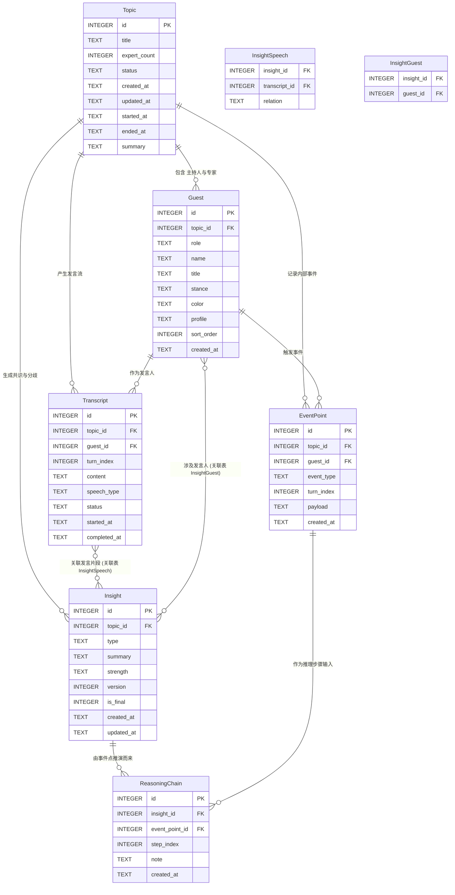
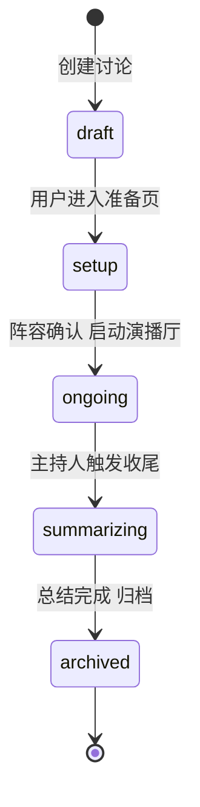
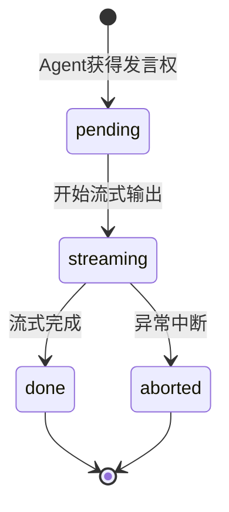

# AI Panel Studio — 数据库设计文档（Schema）

> **文档版本**：v1.0
> **数据库**：SQLite
> **对应 PRD**：§8 数据模型概要、§5 状态机、§6 共识/分歧时机
> **作者**：架构组
> **状态**：基线版（驱动 DDD 阶段）

---

## 0. 文档目的

本文档定义 AI 圆桌讨论 Web App MVP 的底层数据表结构，约束：

- **字段、类型、约束、说明**的可执行定义；
- 实体之间的**关系**（ER 图）；
- **索引**、**枚举值**、**初始化脚本**与**样例数据**要求。

设计目标：支撑 PRD §3 核心业务流程、§5 状态机、§6 实时共识/分歧生成时机，并为多 Agent 调度、SSE 推送、E2E 测试提供持久化基础。

---

## 1. 设计原则

| 原则 | 落地方式 |
|------|----------|
| 与 PRD 实体对齐 | 实体边界严格映射 PRD §8：Topic / Guest / Transcript / EventPoint / Insight / ReasoningChain |
| 状态可追溯 | 内部事件（举手、追问、收尾）独立存表，不混入 Transcript |
| 实时友好 | 关键表带 `status`、`version`、时间戳字段，支持 SSE 增量推送与前端 diff 渲染 |
| 不重写历史 | Insight 只做"强度/摘要修正 + version+1"，不删除旧版本 |
| SQLite 友好 | 无 ARRAY 类型，多对多用关联表；时间用 ISO8601 TEXT；JSON 字段用 TEXT 存 |
| 外键开启 | `PRAGMA foreign_keys = ON`，保证引用完整性 |

---

## 2. ER 图（实体关系）



**关系基数说明**：

| 关系 | 基数 | 说明 |
|------|------|------|
| Topic → Guest | 1 : N | 一场讨论含 1 主持人 + N 专家 |
| Topic → Transcript | 1 : N | 一场讨论含多条发言 |
| Topic → EventPoint | 1 : N | 一场讨论含多次内部事件 |
| Topic → Insight | 1 : N | 一场讨论含多条共识/分歧 |
| Guest → Transcript | 1 : N | 一位嘉宾可多次发言 |
| Guest → EventPoint | 1 : N | 一位嘉宾可触发多个事件 |
| Insight ↔ Transcript | M : N | 一条 Insight 关联多个发言片段，反之亦然 |
| Insight ↔ Guest | M : N | 一条 Insight 涉及多位发言人 |
| Insight → ReasoningChain | 1 : N | 一条 Insight 的推理步骤序列 |
| EventPoint → ReasoningChain | 1 : N | 一个事件点可被多条推理链引用 |

---

## 3. 表结构定义

### 3.1 `topic` — 话题/讨论

承载一场圆桌讨论的元信息与状态。对应 PRD §3 阶段流转。

| 字段 | 类型 | 约束 | 说明 |
|------|------|------|------|
| `id` | INTEGER | PK AUTOINCREMENT | 主键 |
| `title` | TEXT | NOT NULL | 讨论话题标题（用户输入） |
| `expert_count` | INTEGER | NOT NULL DEFAULT 4 | 专家人数（2-6，默认 4） |
| `status` | TEXT | NOT NULL DEFAULT 'draft' | 讨论状态（见枚举 §5.1） |
| `created_at` | TEXT | NOT NULL | 创建时间 ISO8601 |
| `updated_at` | TEXT | NOT NULL | 更新时间 ISO8601 |
| `started_at` | TEXT | NULL | 进入演播厅时间（status=ongoing 时写入） |
| `ended_at` | TEXT | NULL | 收尾完成时间（status=archived 时写入） |
| `summary` | TEXT | NULL | 主持人收尾总结（自然语言，非 JSON） |

**索引**：
- `idx_topic_status` on (`status`) — 首页按状态过滤
- `idx_topic_updated_at` on (`updated_at` DESC) — 首页按最近更新排序

---

### 3.2 `guest` — 嘉宾（主持人/专家角色）

承载主持人 + 专家阵容档案。对应 PRD §4.2 阵容展示字段。

| 字段 | 类型 | 约束 | 说明 |
|------|------|------|------|
| `id` | INTEGER | PK AUTOINCREMENT | 主键 |
| `topic_id` | INTEGER | FK→topic.id, NOT NULL | 所属讨论 |
| `role` | TEXT | NOT NULL | 角色：`moderator` / `expert` |
| `name` | TEXT | NOT NULL | 姓名 |
| `title` | TEXT | NOT NULL | 职业/Title（如"经济学教授"） |
| `stance` | TEXT | NULL | 立场描述（moderator 可空） |
| `color` | TEXT | NOT NULL | 专属颜色标识（如 `#E63946`） |
| `profile` | TEXT | NULL | 专家详细档案 JSON（背景、风格、口头禅等） |
| `sort_order` | INTEGER | NOT NULL DEFAULT 0 | 座位/展示顺序 |
| `created_at` | TEXT | NOT NULL | 创建时间 ISO8601 |

**约束**：
- `CHECK (role IN ('moderator','expert'))`
- `CHECK (expert_count_per_topic)`：每场讨论恰好 1 位 moderator + N 位 expert（N = topic.expert_count），由应用层校验。

**索引**：
- `idx_guest_topic_id` on (`topic_id`, `sort_order`) — 按讨论取嘉宾列表

---

### 3.3 `transcript` — 实时发言流

承载每位嘉宾的发言记录。对应 PRD §4.3 Transcript 区，**不记录"举手"等内部事件**（内部事件入 `event_point`）。

| 字段 | 类型 | 约束 | 说明 |
|------|------|------|------|
| `id` | INTEGER | PK AUTOINCREMENT | 主键 |
| `topic_id` | INTEGER | FK→topic.id, NOT NULL | 所属讨论 |
| `guest_id` | INTEGER | FK→guest.id, NOT NULL | 发言人 |
| `turn_index` | INTEGER | NOT NULL | 发言轮次序号（同讨论内递增，用于排序） |
| `content` | TEXT | NOT NULL | 发言内容（流式完成后写入完整文本） |
| `speech_type` | TEXT | NOT NULL | 发言类型（见枚举 §5.2） |
| `status` | TEXT | NOT NULL DEFAULT 'pending' | 流式状态（见枚举 §5.3） |
| `started_at` | TEXT | NULL | 开始流式时间 |
| `completed_at` | TEXT | NULL | 流式完成时间 |

**约束**：
- `UNIQUE (topic_id, turn_index)` — 同讨论内轮次不重复
- `CHECK (status IN ('pending','streaming','done','aborted'))`
- `CHECK (speech_type IN ('opening','followup','rebute','supplement','grab','summary'))`

**索引**：
- `idx_transcript_topic_turn` on (`topic_id`, `turn_index`) — 按讨论取发言流
- `idx_transcript_guest` on (`guest_id`) — 按嘉宾取发言历史
- `idx_transcript_status` on (`status`) — 查询流式中的发言

---

### 3.4 `event_point` — 内部事件点

承载 UI 不可见的内部事件（举手信号、抢答仲裁、主持人介入、收尾触发）。对应 PRD §5.3 抢答仲裁与 §6.2 抽取事件触发。

| 字段 | 类型 | 约束 | 说明 |
|------|------|------|------|
| `id` | INTEGER | PK AUTOINCREMENT | 主键 |
| `topic_id` | INTEGER | FK→topic.id, NOT NULL | 所属讨论 |
| `guest_id` | INTEGER | FK→guest.id, NULL | 触发者（系统触发可空） |
| `event_type` | TEXT | NOT NULL | 事件类型（见枚举 §5.4） |
| `turn_index` | INTEGER | NULL | 关联的 Transcript 轮次（可空） |
| `payload` | TEXT | NULL | 事件负载 JSON（如 `{"priority":"rebute","reason":"..."}`） |
| `created_at` | TEXT | NOT NULL | 事件时间 ISO8601 |

**约束**：
- `CHECK (event_type IN ('hand_raise','grab_arbitration','grab_result','moderator_intervene','consensus_extract_trigger','closing_trigger'))`

**索引**：
- `idx_event_topic_turn` on (`topic_id`, `turn_index`) — 按讨论轮次取事件
- `idx_event_type` on (`event_type`) — 按类型查询

---

### 3.5 `insight` — 共识与分歧条目

承载 chain-of-thought 区的核心数据。对应 PRD §6.4 数据结构约束。

| 字段 | 类型 | 约束 | 说明 |
|------|------|------|------|
| `id` | INTEGER | PK AUTOINCREMENT | 主键 |
| `topic_id` | INTEGER | FK→topic.id, NOT NULL | 所属讨论 |
| `type` | TEXT | NOT NULL | `consensus` / `divergence` |
| `summary` | TEXT | NOT NULL | 一句话摘要（≤ 30 字，应用层校验） |
| `strength` | TEXT | NOT NULL DEFAULT 'weak' | 强度：`weak` / `medium` / `strong` |
| `version` | INTEGER | NOT NULL DEFAULT 1 | 版本号，增量更新时 +1 |
| `is_final` | INTEGER | NOT NULL DEFAULT 0 | 是否最终版（0/1），收尾时置 1 |
| `created_at` | TEXT | NOT NULL | 创建时间 |
| `updated_at` | TEXT | NOT NULL | 更新时间 |

**约束**：
- `CHECK (type IN ('consensus','divergence'))`
- `CHECK (strength IN ('weak','medium','strong'))`
- `CHECK (is_final IN (0,1))`

**索引**：
- `idx_insight_topic` on (`topic_id`, `type`) — 按讨论取共识/分歧列表
- `idx_insight_updated` on (`topic_id`, `updated_at` DESC) — SSE 增量推送按时间排序
- `idx_insight_final` on (`topic_id`, `is_final`) — 取最终版

---

### 3.6 `insight_speech` — Insight 与 Transcript 多对多关联表

记录一条 Insight 关联哪些发言片段，及关联关系类型。

| 字段 | 类型 | 约束 | 说明 |
|------|------|------|------|
| `insight_id` | INTEGER | FK→insight.id, NOT NULL | Insight ID |
| `transcript_id` | INTEGER | FK→transcript.id, NOT NULL | Transcript ID |
| `relation` | TEXT | NOT NULL | 关联类型：`support`（支持） / `refute`（反驳） |

**约束**：
- `PRIMARY KEY (insight_id, transcript_id)`
- `CHECK (relation IN ('support','refute'))`

**索引**：
- `idx_insight_speech_transcript` on (`transcript_id`) — 反查某发言关联的 Insight

---

### 3.7 `insight_guest` — Insight 与 Guest 多对多关联表

记录一条 Insight 涉及哪些发言人（PRD §6.4"关联发言人"）。

| 字段 | 类型 | 约束 | 说明 |
|------|------|------|------|
| `insight_id` | INTEGER | FK→insight.id, NOT NULL | Insight ID |
| `guest_id` | INTEGER | FK→guest.id, NOT NULL | Guest ID |

**约束**：
- `PRIMARY KEY (insight_id, guest_id)`

---

### 3.8 `reasoning_chain` — 推理链路

记录一条 Insight 如何由哪些内部事件点推演而来（PRD §6.4"推理链路"）。

| 字段 | 类型 | 约束 | 说明 |
|------|------|------|------|
| `id` | INTEGER | PK AUTOINCREMENT | 主键 |
| `insight_id` | INTEGER | FK→insight.id, NOT NULL | 所属 Insight |
| `event_point_id` | INTEGER | FK→event_point.id, NOT NULL | 推理输入事件点 |
| `step_index` | INTEGER | NOT NULL | 推理步骤序号 |
| `note` | TEXT | NULL | 推理说明（自然语言） |
| `created_at` | TEXT | NOT NULL | 创建时间 |

**约束**：
- `UNIQUE (insight_id, step_index)` — 同 Insight 内步骤序号不重复

**索引**：
- `idx_reasoning_insight` on (`insight_id`, `step_index`) — 按 Insight 取推理链

---

## 4. 状态字段流转图

### 4.1 `topic.status` 流转

对应 PRD §3.2 阶段定义。



### 4.2 `transcript.status` 流转



---

## 5. 枚举值定义

### 5.1 `topic.status`

| 值 | 含义 | 首页可见 |
|----|------|----------|
| `draft` | 草稿，话题已输入未生成阵容 | ❌ |
| `setup` | 准备页，阵容生成中或待确认 | ❌ |
| `ongoing` | 演播厅进行中 | ✅ |
| `summarizing` | 主持人收尾中 | ✅ |
| `archived` | 已归档，可回放 | ✅ |

### 5.2 `transcript.speech_type`

| 值 | 含义 | 发言人 |
|----|------|--------|
| `opening` | 开场白 | moderator |
| `followup` | 追问/串联 | moderator |
| `summary` | 收尾总结 | moderator |
| `grab` | 抢答发言 | expert |
| `rebute` | 反驳 | expert |
| `supplement` | 补充 | expert |

### 5.3 `transcript.status`

| 值 | 含义 |
|----|------|
| `pending` | 已获发言权，未开始流式 |
| `streaming` | 流式输出中 |
| `done` | 流式完成 |
| `aborted` | 异常中断 |

### 5.4 `event_point.event_type`

| 值 | 含义 | UI 可见 |
|----|------|---------|
| `hand_raise` | 专家举手 | ❌ |
| `grab_arbitration` | 抢答仲裁 | ❌ |
| `grab_result` | 仲裁结果 | ❌ |
| `moderator_intervene` | 主持人介入（追问/串联） | ✅（仅结果） |
| `consensus_extract_trigger` | 共识/分歧抽取触发 | ❌ |
| `closing_trigger` | 收尾触发 | ❌ |

### 5.5 `insight.type` / `strength`

| 字段 | 值 |
|------|-----|
| `type` | `consensus` / `divergence` |
| `strength` | `weak` / `medium` / `strong` |

---

## 6. 索引汇总

| 索引名 | 表 | 字段 | 用途 |
|--------|----|----|------|
| `idx_topic_status` | topic | status | 首页状态过滤 |
| `idx_topic_updated_at` | topic | updated_at DESC | 首页排序 |
| `idx_guest_topic_id` | guest | topic_id, sort_order | 嘉宾列表 |
| `idx_transcript_topic_turn` | transcript | topic_id, turn_index | 发言流 |
| `idx_transcript_guest` | transcript | guest_id | 嘉宾发言历史 |
| `idx_transcript_status` | transcript | status | 查询流式中发言 |
| `idx_event_topic_turn` | event_point | topic_id, turn_index | 按轮次取事件 |
| `idx_event_type` | event_point | event_type | 按类型查询 |
| `idx_insight_topic` | insight | topic_id, type | 按讨论取共识/分歧 |
| `idx_insight_updated` | insight | topic_id, updated_at DESC | SSE 增量推送 |
| `idx_insight_final` | insight | topic_id, is_final | 取最终版 |
| `idx_insight_speech_transcript` | insight_speech | transcript_id | 反查关联 |
| `idx_reasoning_insight` | reasoning_chain | insight_id, step_index | 推理链 |

---

## 7. 初始化脚本说明

### 7.1 建表脚本

> 完整 DDL 见 `scripts/schema.sql`。本节列关键约定。

```sql
PRAGMA foreign_keys = ON;

-- 1. 话题/讨论
CREATE TABLE IF NOT EXISTS topic (
    id INTEGER PRIMARY KEY AUTOINCREMENT,
    title TEXT NOT NULL,
    expert_count INTEGER NOT NULL DEFAULT 4 CHECK (expert_count BETWEEN 2 AND 6),
    status TEXT NOT NULL DEFAULT 'draft',
    created_at TEXT NOT NULL,
    updated_at TEXT NOT NULL,
    started_at TEXT,
    ended_at TEXT,
    summary TEXT
);

-- 2. 嘉宾（主持人/专家）
CREATE TABLE IF NOT EXISTS guest (
    id INTEGER PRIMARY KEY AUTOINCREMENT,
    topic_id INTEGER NOT NULL REFERENCES topic(id) ON DELETE CASCADE,
    role TEXT NOT NULL CHECK (role IN ('moderator','expert')),
    name TEXT NOT NULL,
    title TEXT NOT NULL,
    stance TEXT,
    color TEXT NOT NULL,
    profile TEXT,
    sort_order INTEGER NOT NULL DEFAULT 0,
    created_at TEXT NOT NULL
);

-- 3. 实时发言流
CREATE TABLE IF NOT EXISTS transcript (
    id INTEGER PRIMARY KEY AUTOINCREMENT,
    topic_id INTEGER NOT NULL REFERENCES topic(id) ON DELETE CASCADE,
    guest_id INTEGER NOT NULL REFERENCES guest(id) ON DELETE CASCADE,
    turn_index INTEGER NOT NULL,
    content TEXT NOT NULL,
    speech_type TEXT NOT NULL CHECK (speech_type IN ('opening','followup','rebute','supplement','grab','summary')),
    status TEXT NOT NULL DEFAULT 'pending' CHECK (status IN ('pending','streaming','done','aborted')),
    started_at TEXT,
    completed_at TEXT,
    UNIQUE (topic_id, turn_index)
);

-- 4. 内部事件点
CREATE TABLE IF NOT EXISTS event_point (
    id INTEGER PRIMARY KEY AUTOINCREMENT,
    topic_id INTEGER NOT NULL REFERENCES topic(id) ON DELETE CASCADE,
    guest_id INTEGER REFERENCES guest(id) ON DELETE SET NULL,
    event_type TEXT NOT NULL CHECK (event_type IN ('hand_raise','grab_arbitration','grab_result','moderator_intervene','consensus_extract_trigger','closing_trigger')),
    turn_index INTEGER,
    payload TEXT,
    created_at TEXT NOT NULL
);

-- 5. 共识与分歧
CREATE TABLE IF NOT EXISTS insight (
    id INTEGER PRIMARY KEY AUTOINCREMENT,
    topic_id INTEGER NOT NULL REFERENCES topic(id) ON DELETE CASCADE,
    type TEXT NOT NULL CHECK (type IN ('consensus','divergence')),
    summary TEXT NOT NULL,
    strength TEXT NOT NULL DEFAULT 'weak' CHECK (strength IN ('weak','medium','strong')),
    version INTEGER NOT NULL DEFAULT 1,
    is_final INTEGER NOT NULL DEFAULT 0 CHECK (is_final IN (0,1)),
    created_at TEXT NOT NULL,
    updated_at TEXT NOT NULL
);

-- 6. Insight ↔ Transcript 关联
CREATE TABLE IF NOT EXISTS insight_speech (
    insight_id INTEGER NOT NULL REFERENCES insight(id) ON DELETE CASCADE,
    transcript_id INTEGER NOT NULL REFERENCES transcript(id) ON DELETE CASCADE,
    relation TEXT NOT NULL CHECK (relation IN ('support','refute')),
    PRIMARY KEY (insight_id, transcript_id)
);

-- 7. Insight ↔ Guest 关联
CREATE TABLE IF NOT EXISTS insight_guest (
    insight_id INTEGER NOT NULL REFERENCES insight(id) ON DELETE CASCADE,
    guest_id INTEGER NOT NULL REFERENCES guest(id) ON DELETE CASCADE,
    PRIMARY KEY (insight_id, guest_id)
);

-- 8. 推理链路
CREATE TABLE IF NOT EXISTS reasoning_chain (
    id INTEGER PRIMARY KEY AUTOINCREMENT,
    insight_id INTEGER NOT NULL REFERENCES insight(id) ON DELETE CASCADE,
    event_point_id INTEGER NOT NULL REFERENCES event_point(id) ON DELETE CASCADE,
    step_index INTEGER NOT NULL,
    note TEXT,
    created_at TEXT NOT NULL,
    UNIQUE (insight_id, step_index)
);
```

### 7.2 索引脚本

```sql
CREATE INDEX IF NOT EXISTS idx_topic_status ON topic(status);
CREATE INDEX IF NOT EXISTS idx_topic_updated_at ON topic(updated_at DESC);
CREATE INDEX IF NOT EXISTS idx_guest_topic_id ON guest(topic_id, sort_order);
CREATE INDEX IF NOT EXISTS idx_transcript_topic_turn ON transcript(topic_id, turn_index);
CREATE INDEX IF NOT EXISTS idx_transcript_guest ON transcript(guest_id);
CREATE INDEX IF NOT EXISTS idx_transcript_status ON transcript(status);
CREATE INDEX IF NOT EXISTS idx_event_topic_turn ON event_point(topic_id, turn_index);
CREATE INDEX IF NOT EXISTS idx_event_type ON event_point(event_type);
CREATE INDEX IF NOT EXISTS idx_insight_topic ON insight(topic_id, type);
CREATE INDEX IF NOT EXISTS idx_insight_updated ON insight(topic_id, updated_at DESC);
CREATE INDEX IF NOT EXISTS idx_insight_final ON insight(topic_id, is_final);
CREATE INDEX IF NOT EXISTS idx_insight_speech_transcript ON insight_speech(transcript_id);
CREATE INDEX IF NOT EXISTS idx_reasoning_insight ON reasoning_chain(insight_id, step_index);
```

### 7.3 样例数据要求（对应 PRD §3.1 交付物）

- **至少 5 条**高质量样例数据，每条含：预设话题 + 对应嘉宾阵容（1 主持人 + N 专家）。
- 样例应覆盖不同 `topic.status`：≥1 条 `ongoing`、≥1 条 `archived`。
- 样例应覆盖不同 `insight.type`：每条 archived 话题含 ≥1 consensus + ≥1 divergence。
- 样例数据脚本见 `scripts/seed.sql`。

---

## 8. API 契约与 Schema 映射

> 详细 OpenAPI 定义见 `docs/api.md`，本节列主要端点与表映射。

| 端点 | 方法 | 读写表 |
|------|------|--------|
| `/api/topics` | GET | topic |
| `/api/topics` | POST | topic |
| `/api/topics/:id` | GET | topic, guest |
| `/api/topics/:id/roster/generate` | POST | guest（暂存候选） |
| `/api/topics/:id/roster/confirm` | POST | topic.status, guest |
| `/api/topics/:id/stream` | GET (SSE) | transcript, event_point, insight（增量） |
| `/api/topics/:id/summary` | GET | topic.summary |
| `/api/topics/:id/replay` | GET | topic, guest, transcript, insight, reasoning_chain |

---

## 9. 与 PRD 状态机/时机的对应

| PRD 约束 | Schema 落地 |
|----------|-------------|
| §5 主持人/专家状态机（待机/准备/发言中） | `event_point` 记录举手/仲裁/介入；`transcript.status` 记录发言流状态 |
| §5.3 抢答仲裁 | `event_point.event_type` = `hand_raise` / `grab_arbitration` / `grab_result`，`payload` 存优先级与时间戳 |
| §6.2 每轮发言完成触发抽取 | `event_point.event_type` = `consensus_extract_trigger`，`turn_index` 关联轮次 |
| §6.4 不重写历史 | `insight.version` 递增，旧版本保留 |
| §6.4 关联发言片段 | `insight_speech` 多对多关联 |
| §6.4 关联发言人 | `insight_guest` 多对多关联 |
| §6.4 推理链路 | `reasoning_chain` 关联 `event_point` |
| §6.5 最终版标记 | `insight.is_final` 收尾时置 1 |

---

## 10. 变更记录

| 版本 | 日期 | 变更内容 |
|------|------|----------|
| v1.0 | 2026-10-08 | 基线版：8 张表 + ER 图 + 索引 + 枚举 + DDL |

---

> **下一步**：本文档驱动 DDD 阶段的 API 契约生成（`docs/api.md`）与 OOD 阶段的前端类型定义。样例数据脚本 `scripts/seed.sql` 与 DDL `scripts/schema.sql` 将在实现阶段产出。
